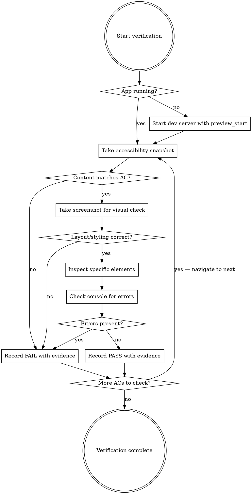

# Browser Verification

Systematic method for verifying frontend implementations against acceptance criteria using Claude Code's preview tools. This skill replaces self-assessment ("I implemented it, so it works") with evidence-based verification ("I looked at it and confirmed it works").

## When to Use

- Gate 3 of the five-gate autonomous review (build plan acceptance criteria marked "Verifiable by browser")
- Epic smoke tests — walking through complete user flows
- Any time you need to verify that UI renders correctly, navigation works, or screen states are implemented
- Regression checking after changes to shared components

## When NOT to Use

- Verifying backend/API behavior (use curl or command-line checks)
- Checking build/lint/test results (use Gate 1 automated checks)
- Reviewing code quality (use Gate 5 code review)

## Tool Availability

This skill's steps are written against `preview_*` tools. If those are not available in the current environment, use the equivalent available browser tooling (e.g., the claude-in-chrome MCP tools) — the method is identical, only the tool names differ:

| Referenced tool | claude-in-chrome equivalent |
|-----------------|-----------------------------|
| `preview_start` | Start the dev server with Bash (background), open the URL in a new tab |
| `preview_snapshot` | `read_page` (accessibility snapshot) |
| `preview_screenshot` | `computer` (screenshot action) |
| `preview_inspect` | `javascript_tool` with `getComputedStyle` |
| `preview_console_logs` | `read_console_messages` |
| `preview_click` / `preview_fill` | `computer` (click/type) or `form_input` |
| `preview_eval` | `javascript_tool` |
| `preview_network` | `read_network_requests` |
| `preview_resize` | `resize_window` |

For a static HTML file (e.g., a Session 3 prototype), skip the dev server entirely — open the file directly in the browser.

## Prerequisites

The application must be running. If it's not already started, use `preview_start` (or the mapped equivalent above) to launch the dev server before beginning verification.

## Core Process



## Verification Methods — When to Use Each Tool

| Tool | Best for | Not for |
|------|----------|---------|
| `preview_snapshot` | Verifying text content, element presence, page structure, button labels, form fields | Visual styling, colors, layout |
| `preview_screenshot` | Checking layout, general appearance, visual regressions | Verifying exact colors, font sizes, precise CSS values |
| `preview_inspect` | Verifying exact CSS values (colors, padding, font-size, border-radius), computed styles | General page structure, text content |
| `preview_console_logs` | Checking for runtime errors, warnings, debug output | Visual checks |
| `preview_click` | Testing navigation, button interactions, form submissions | Verifying static content |
| `preview_fill` | Testing form inputs, search fields | Non-input interactions |
| `preview_eval` | Reading JS state, checking variables, triggering hover/key events | Modifying the app (use source code edits instead) |
| `preview_network` | Checking API calls, failed requests, response payloads | Visual checks |

## Step-by-Step Protocol

### Step 1: Ensure the App Is Running

Check if the dev server is running with `preview_list`. If not, start it with `preview_start`.

### Step 2: Navigate to the Target Page

Use `preview_eval` with `window.location.href = '/target-path'` or `preview_click` on navigation elements to reach the page being verified.

### Step 3: For Each Acceptance Criteria Item

**3a. Content verification — use `preview_snapshot`**

The accessibility snapshot returns the exact text content, roles, and element structure. Use it to verify:
- Text content is correct ("No captures yet" message appears)
- Buttons/links exist with correct labels
- Form fields are present with correct placeholders
- Lists have the expected number of items
- Headings, navigation items, and structural elements are present

**3b. Visual verification — use `preview_screenshot`**

Take a screenshot to verify:
- Layout is correct (sidebar is on the left, content fills the space)
- Components are visible and positioned correctly
- Empty/loading/error states render as expected
- No visual glitches (overlapping elements, clipped text)

**3c. Style verification — use `preview_inspect`**

For precise CSS verification:
```
preview_inspect(selector=".button-primary", styles=["background-color", "color", "border-radius", "padding"])
```

Use this to verify:
- Colors match the design system hex values
- Typography matches the specified font-family, font-size, font-weight
- Spacing matches the design system spacing scale
- Border radius, shadows, and other decorative properties are correct

**3d. Interaction verification — use `preview_click` and `preview_fill`**

Test that interactions work:
- Click a button and verify the result (navigation, modal opening, state change)
- Fill a form and submit it
- Click a navigation link and verify the correct page loads

After each interaction, take a new snapshot or screenshot to verify the result.

**3e. Error check — use `preview_console_logs`**

After loading the page and performing interactions:
```
preview_console_logs(level="error")
```

Any console errors are an automatic FAIL unless the AC explicitly expects them.

### Step 4: Check Network Requests (When Relevant)

For pages that make API calls:
```
preview_network(filter="failed")
```

Failed network requests (4xx/5xx) are an automatic FAIL unless the AC is specifically testing error handling.

### Step 5: Record Results

For each acceptance criteria item, record:

```
[PASS] [criteria text] — [evidence: what tool you used and what you saw]
[FAIL] [criteria text] — [evidence: what tool you used, what you expected, what you actually saw]
```

**Evidence is mandatory.** Never record a PASS without stating what you actually observed. "I implemented it" is not evidence. "preview_snapshot shows 'No captures yet' text in the main content area" is evidence.

## Verifying Screen States

The masterplan's screen architecture specifies four states for every data-driven screen. Verify each:

### Empty State
1. Ensure no data exists (or clear test data)
2. Navigate to the page
3. `preview_snapshot` — verify empty state message and CTA text
4. `preview_screenshot` — verify layout looks intentional, not broken

### Loading State
1. This is harder to capture because it's transient
2. Use `preview_eval` to check if a loading indicator exists in the DOM:
   ```js
   document.querySelector('.loading-skeleton, .spinner, [aria-busy="true"]') !== null
   ```
3. If the app uses skeleton screens, take a screenshot during initial load

### Populated State
1. Ensure test data exists
2. Navigate to the page
3. `preview_snapshot` — verify data renders in the expected structure
4. `preview_screenshot` — verify layout with data

### Error State
1. If possible, trigger an error condition (disconnect API, invalid data)
2. Navigate to the page
3. `preview_snapshot` — verify error message and recovery CTA
4. `preview_screenshot` — verify error state looks intentional

## Responsive Verification (When Required)

If the masterplan specifies responsive behavior:

```
preview_resize(preset="mobile")
# Take snapshot and screenshot
# Verify mobile layout

preview_resize(preset="tablet")
# Take snapshot and screenshot
# Verify tablet layout

preview_resize(preset="desktop")
# Restore desktop layout
```

## Epic Smoke Test Protocol

During epic smoke tests, walk through the entire user flow:

1. Start at the entry point of the flow
2. For each step in the flow:
   a. Take a snapshot to verify correct page/state
   b. Perform the user action (click, fill, navigate)
   c. Take a snapshot to verify the result
   d. Check console for errors
3. Complete the flow end-to-end
4. Then repeat for ALL previous epic flows (regression check)

## Common Mistakes

| Mistake | Fix |
|---------|-----|
| Recording PASS without using any verification tool | Always use at least `preview_snapshot` for content or `preview_screenshot` for visual |
| Using screenshot to verify exact colors | Use `preview_inspect` with specific CSS properties instead |
| Not checking console errors | Always run `preview_console_logs(level="error")` after page load |
| Skipping empty/error states | The masterplan specifies all states — verify all of them |
| Not navigating to the actual page before verifying | Always confirm the URL is correct before checking content |
| Assuming interaction worked without checking result | After every click/fill, take a new snapshot to verify the state changed |

## Report Format

At the end of Gate 3, produce a summary:

```
## Gate 3 — Browser Verification Report

**Page: /captures**
[PASS] Empty state shows "No captures yet" message — snapshot confirmed text present in main content area
[PASS] Empty state shows "Create your first capture" CTA button — snapshot confirmed button with correct label
[FAIL] Loading skeleton not implemented — screenshot shows flash of empty content before data loads, no skeleton elements in DOM

**Page: /captures/:id**
[PASS] Capture detail shows title, status, and timestamp — snapshot confirmed all fields present
[PASS] Back button navigates to /captures — clicked back button, snapshot confirmed captures list page loaded

**Console errors: None**
**Failed network requests: None**

**Result: 4/5 PASS — 1 failure requires fix before advancing**
```
