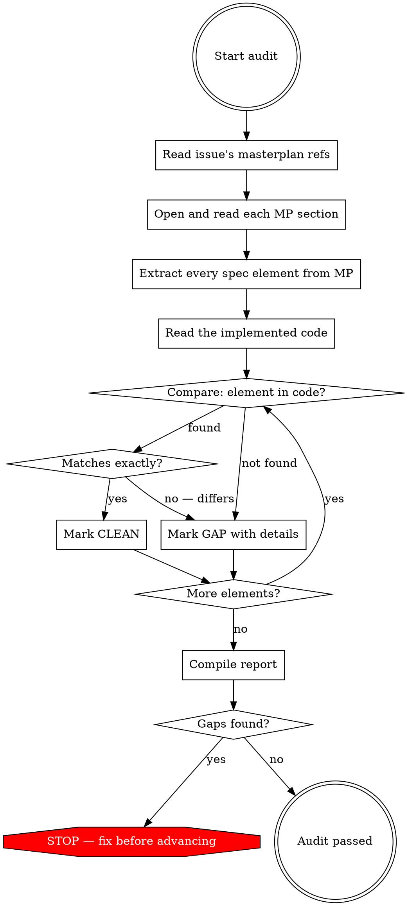

# Masterplan Cross-Reference Audit

Systematic method for comparing implemented code against the masterplan specification to find gaps. This is an execution-time verification — it checks what was actually built against what was specified, not what was planned (that's the traceability matrix's job).

## When to Use

- Gate 4 of the five-gate autonomous review — after each issue is completed
- Epic smoke tests — verifying the full epic against its masterplan sections
- When you suspect implementation drift from the specification
- After fixing bugs that might have introduced spec deviations

## When NOT to Use

- Before code is written (use `traceability-matrix` instead — that checks build plan against masterplan)
- For code quality review (use Gate 5 code-reviewer agent)
- For browser verification (use `browser-verification` skill)

## Core Principle

**The auditor reads the masterplan fresh, not from memory.** Every time this skill runs, the agent must re-read the relevant masterplan sections. Never audit from what you "remember" the masterplan says — context drift is exactly what this skill catches.

## Process



## Step-by-Step Protocol

### Step 1: Identify Masterplan Sections

Read the current issue's metadata to find which masterplan sections it references:

```
**Masterplan:** §7 API Design → POST /captures, §6 Database → captures table
```

### Step 1.5: Check the Masterplan Changelog

Before reading the referenced sections, check the masterplan's **§ Changelog** table. If any referenced section was modified since the issue was written, the issue's acceptance criteria may be outdated. Flag this:

```
[NOTE] Masterplan §8 API Design was updated on [date]: "switched from polling to webhooks"
       Issue E3-05 was written before this change — verify AC still matches current masterplan
```

This catches a subtle failure mode: the issue references the right section, but the section has changed since the issue was written.

### Step 2: Read the Masterplan Sections (Fresh)

Open the masterplan file. Read every referenced section completely. Do not skim. Do not rely on what you "know" from having written the code — the whole point is to catch things you missed while implementing.

As you read, extract a checklist of every discrete specification element:

**From a database schema section, extract:**
- Every table name
- Every column (name, type, constraints, defaults)
- Every foreign key relationship
- Every index
- Every enum/constraint set
- Every RLS policy mentioned

**From an API design section, extract:**
- Every endpoint (method + path)
- Every request field (name, type, required/optional)
- Every response field (name, type)
- Every error case and its response code/shape
- Auth requirements
- Pagination/filtering parameters

**From a screen architecture section, extract:**
- Every component on the screen
- Every state (empty, loading, populated, error)
- Every navigation target
- Every interaction behavior described

**From user flows, extract:**
- Every step in the flow
- Every validation rule mentioned
- Every error handling behavior
- Every state transition

### Step 3: Read the Implemented Code

Read every file that was created or modified by this issue. Read them completely — do not skim.

### Step 4: Compare Element by Element

For each specification element extracted in Step 2, check whether the code implements it:

**For database columns:**
- Does the migration/schema file include this column?
- Is the type correct? (e.g., masterplan says `TIMESTAMPTZ`, code uses `TIMESTAMP` — that's a gap)
- Are constraints correct? (NOT NULL, DEFAULT, CHECK)
- Are foreign keys present?

**For API endpoints:**
- Does the route handler exist?
- Does it accept the correct request fields?
- Does it return the correct response shape?
- Does it handle the specified error cases?
- Is auth enforced as specified?

**For UI components:**
- Does the component exist on the screen?
- Does it render in all specified states?
- Does it contain the correct content/labels?
- Does navigation work to all specified targets?

**For constraints and behaviors:**
- Is the validation rule implemented?
- Is the error message correct?
- Is the state transition handled?

### Step 5: Compile Report

```
## Gate 4 — Masterplan Cross-Reference Report

**Issue:** E3-04 — Capture Processing Pipeline
**Masterplan sections audited:** §7 captures table, §8 POST /api/captures, §8 GET /api/captures

### §7 Database — captures table

[CLEAN] Table exists with correct name
[CLEAN] id column: UUID, PRIMARY KEY, DEFAULT gen_random_uuid()
[CLEAN] user_id column: UUID, NOT NULL, FK → auth.users
[CLEAN] text column: TEXT, NOT NULL
[CLEAN] status column: TEXT, NOT NULL, DEFAULT 'pending'
[GAP] status CHECK constraint missing → masterplan specifies CHECK (status IN ('pending', 'processing', 'complete', 'failed')) but migration has no CHECK constraint
[CLEAN] created_at column: TIMESTAMPTZ, DEFAULT now()
[GAP] updated_at column missing → masterplan specifies TIMESTAMPTZ with trigger, column not in migration
[CLEAN] RLS policy: users see own rows

### §8 API — POST /api/captures

[CLEAN] Endpoint exists at correct path
[CLEAN] Accepts { text: string } in request body
[CLEAN] Returns 201 with capture object including id
[GAP] Missing error case → masterplan specifies 400 response when text is empty, endpoint does not validate

### §8 API — GET /api/captures

[CLEAN] Endpoint exists at correct path
[CLEAN] Returns array of capture objects
[GAP] Pagination missing → masterplan specifies ?page=1&limit=20 query params, endpoint returns all rows

### Summary

- Elements audited: 15
- Clean: 11
- Gaps: 4

**Result: GAPS FOUND — must fix before advancing to Gate 5**

### Required Fixes

1. Add CHECK constraint to captures.status column
2. Add updated_at column with trigger to captures table
3. Add request body validation to POST /api/captures (return 400 for empty text)
4. Add pagination to GET /api/captures (page + limit query params)
```

## What to Look For — Common Gap Types

| Gap Type | How it manifests | Where to check |
|----------|-----------------|----------------|
| Missing column | Masterplan specifies 14 columns, code has 11 | Compare column lists side by side |
| Wrong type | Masterplan says TIMESTAMPTZ, code says TEXT | Check every column type |
| Missing constraint | Masterplan says NOT NULL or CHECK, code has neither | Check constraint definitions |
| Missing default | Masterplan says DEFAULT 'pending', code has no default | Check DEFAULT clauses |
| Missing endpoint | Masterplan lists 5 endpoints, code implements 4 | Compare endpoint lists |
| Missing error handling | Masterplan specifies 400/404/500 responses, code only handles 200 | Check error branches |
| Missing request field | Masterplan says endpoint accepts 5 fields, code destructures 3 | Compare request shape |
| Missing response field | Masterplan says response includes 8 fields, code returns 5 | Compare response shape |
| Wrong behavior | Masterplan says soft delete, code does hard delete | Check business logic |
| Missing state | Masterplan says 4 screen states, code implements 2 | Check component rendering |
| Missing validation | Masterplan says "email must be valid", code accepts any string | Check input validation |
| Missing relationship | Masterplan says FK to users table, code has no foreign key | Check schema relationships |

## Dispatch Protocol

When running as Gate 4 in the five-gate review, this audit should be dispatched as an agent:

```
Dispatch an agent with the following prompt:

"You are auditing issue [E3-04] for masterplan compliance.

1. Read the issue definition in [product]_buildplan.md to find its masterplan section references
2. Read those sections in [product]_masterplan.md — read them completely, do not skim
3. Read every file listed in the issue's file manifest
4. Compare every specification element against the code, element by element
5. Report using the format: [CLEAN] for matches, [GAP] for mismatches or missing elements
6. List all required fixes if any gaps are found

Be exhaustive. Check every column, every field, every constraint, every error case."
```

## After Fixing Gaps

When gaps are found and fixed:
1. Fix every gap identified in the report
2. Re-run the audit on the fixed code
3. Confirm all previously-identified gaps are now CLEAN
4. Check that fixes didn't introduce new gaps
5. Only proceed to Gate 5 when the report shows zero gaps

## Relationship to Other Skills

| Skill | When it runs | What it compares |
|-------|-------------|-----------------|
| `traceability-matrix` | Planning time (Session 2.5) | Build plan ↔ Masterplan |
| `masterplan-cross-reference-audit` | Execution time (Gate 4) | Code ↔ Masterplan |
| `browser-verification` | Execution time (Gate 3) | Running app ↔ Acceptance criteria |
| Code reviewer (agent) | Execution time (Gate 5) | Code ↔ Quality standards |

These four are complementary:
- Traceability matrix prevents gaps in the plan
- Cross-reference audit prevents gaps in the implementation
- Browser verification prevents UI gaps
- Code review prevents quality gaps
