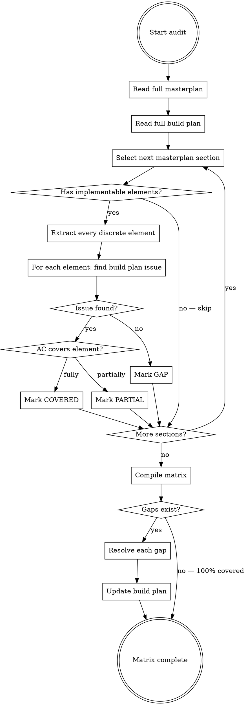

# Traceability Matrix

Systematic method for verifying complete coverage between a product specification (masterplan) and an implementation plan (build plan). Produces a document that maps every discrete, implementable element in the masterplan to its corresponding build plan issue and acceptance criteria.

## When to Use

- Session 2.5 of the tech-idea-to-docs process — after the build plan is written, before prototyping
- Any time you suspect a build plan has coverage gaps
- When reviewing a build plan someone else wrote against a specification
- **After masterplan updates** — re-run for only the affected sections (see "Partial Re-Audit" below)
- When the masterplan changelog shows sections were modified since the last audit

## When NOT to Use

- During execution (use `masterplan-cross-reference-audit` instead — that skill checks code against masterplan)
- For code review (use the code-reviewer agent)
- When there's no formal masterplan to trace against

## Core Principle

**The entity that audits should not be the entity that authored.** This skill should ideally run in a fresh context — a new conversation that reads both documents cold. The agent that wrote the build plan is blind to its own gaps.

## Process



## What Counts as an "Implementable Element"

Not everything in a masterplan is implementable. Extract only elements that require code, configuration, or content.

### Sections with implementable elements:

| Masterplan Section | What to extract |
|-------------------|-----------------|
| Core User Flows | Every numbered step in every flow. Every error/edge case mentioned. |
| Feature Set | Every feature listed. Every "does NOT do" item (verify no issue builds it). |
| Screen Architecture | Every screen. Every component on each screen. Every state (empty, loading, populated, error). Every navigation link. |
| Architecture | Every framework/library choice. Every service integration. |
| Database Schema | Every table. Every column (name, type, constraints). Every foreign key. Every index. Every enum. |
| API Design | Every endpoint (method + path). Every request field. Every response field. Every error case. |
| Design System | Every color value. Every typography rule. Every spacing value. Every component behavior. |
| Testing Strategy | Every test scenario listed as "must have." Every test command. |
| Revenue Model | Every feature gate. Every tier limit. Every billing rule. |

### Sections WITHOUT implementable elements (skip these):

| Section | Why skip |
|---------|----------|
| Product Vision | Narrative, not implementation |
| User Personas | Context for design decisions, not code |
| GTM Strategy | Marketing, not code (unless it specifies in-app referral mechanics etc.) |

## Extraction Granularity

The key question: how granular should elements be?

**Too coarse (misses gaps):**
```
| captures table | E2-03 | COVERED |
```
This would miss 3 columns that the issue forgot to include.

**Too fine (wastes time):**
```
| captures.id is UUID type | E2-03 | COVERED |
| captures.id has DEFAULT gen_random_uuid() | E2-03 | COVERED |
| captures.id is PRIMARY KEY | E2-03 | COVERED |
```
This level of detail is excessive for a planning audit.

**Right granularity:**
```
| captures table — 14 columns as specified in §7 | E2-03 | COVERED |
| captures.status enum: pending, processing, complete, failed | E2-03 AC Gate 2 #2 | COVERED |
| captures RLS policy: users see only own rows | E2-04 | COVERED |
| prompt_registry table — 6 columns | — | GAP |
```

**Rule of thumb:** Each element should be something that could be independently missed. A whole table can be missed. A specific enum constraint can be missed. An individual column within a fully-specified table is unlikely to be independently missed (if the issue says "create table per §7" and §7 has the columns, they'll get created).

**Exception:** If a column is specified in a different location than the main schema (e.g., mentioned in a user flow but not in the schema section), extract it separately because it's easy to miss.

## Matrix Document Structure

```markdown
# Traceability Matrix — [Product Name]

**Masterplan:** `[product]_masterplan.md`
**Build Plan:** `[product]_buildplan.md`
**Audit Date:** [date]
**Audited By:** [fresh context / same context — note which]

## Summary

| Metric | Count |
|--------|-------|
| Total implementable elements | [N] |
| Covered | [N] (X%) |
| Partially covered | [N] (X%) |
| Gaps | [N] (X%) |

## §3 Core User Flows

| # | Masterplan Element | BP Issue | AC Ref | Status |
|---|-------------------|----------|--------|--------|
| 1 | Onboarding flow step 1: three-field form | E4-01 | G3 #1 | COVERED |
| 2 | Onboarding flow step 2: email validation | E4-01 | G3 #3 | COVERED |
| 3 | Onboarding error: duplicate email message | — | — | GAP |

## §5 Screen Architecture

| # | Masterplan Element | BP Issue | AC Ref | Status |
|---|-------------------|----------|--------|--------|
| 1 | Dashboard screen: empty state | E5-01 | G3 #2 | COVERED |
| 2 | Dashboard screen: loading skeleton | — | — | GAP |
| 3 | Dashboard screen: error state | — | — | GAP |
| 4 | Dashboard screen: populated state | E5-01 | G3 #1 | COVERED |
| 5 | Dashboard → Captures navigation | E5-01 | G3 #4 | COVERED |

## §7 Database Schema

| # | Masterplan Element | BP Issue | AC Ref | Status |
|---|-------------------|----------|--------|--------|
| 1 | `captures` table — 14 columns per spec | E2-03 | G4 #1 | COVERED |
| 2 | `captures` RLS: users see own rows only | E2-04 | G2 #1 | COVERED |
| 3 | `prompt_registry` table — 6 columns | — | — | GAP |
| 4 | `prompt_registry` seed data (3 defaults) | — | — | GAP |

## §8 API Design

| # | Masterplan Element | BP Issue | AC Ref | Status |
|---|-------------------|----------|--------|--------|
| 1 | POST /api/captures — 201 with capture ID | E3-04 | G2 #1 | COVERED |
| 2 | GET /api/captures — paginated list | E3-04 | G2 #2 | COVERED |
| 3 | DELETE /api/captures/:id — soft delete | — | — | GAP |
| 4 | GET /api/captures/:id/status — SSE stream | E3-05 | G2 #1 | COVERED |

[Continue for all sections with implementable elements]

## Gap Resolution

### GAP-1: Onboarding error — duplicate email message (§3 #3)
**Resolution:** Add Gate 3 acceptance criteria to E4-01:
`- [ ] Submitting a duplicate email shows "This email is already registered" error`
**Status:** Build plan updated

### GAP-2: Dashboard loading skeleton (§5 #2)
**Resolution:** Create new issue E5-01b — Dashboard loading and error states
**Status:** Build plan updated

### GAP-3: prompt_registry table (§7 #3-4)
**Resolution:** Create new issue E2-05 — Prompt registry table and seed data
**Status:** Build plan updated

### GAP-4: DELETE /api/captures/:id (§8 #3)
**Resolution:** Intentional omission — soft delete deferred to post-MVP per user approval
**Status:** Documented as intentional
```

## Quality Criteria

The traceability matrix is complete when:

1. **Every masterplan section with implementable elements has been audited** — no sections skipped
2. **Every discrete element has a row** — not just "this section is covered" but each element within it
3. **Every COVERED element cites the specific issue AND acceptance criteria reference** — not just "E2-03" but "E2-03, Gate 4 AC #1"
4. **Every GAP has a resolution** — either the build plan was updated, or the omission is documented as intentional with user approval
5. **The build plan has been updated** to reflect all new issues and criteria discovered
6. **Final coverage is 100%** — all elements are either COVERED or intentionally omitted with documented reason

## Common Gap Patterns

These are the most frequently missed elements. Pay extra attention:

| Pattern | Where to look | Why it's missed |
|---------|--------------|-----------------|
| Screen states | §5 Screen Architecture | Build plan says "build dashboard" but doesn't specify empty/loading/error states |
| Error cases in flows | §3 Core User Flows | Build plan covers happy path but skips error handling steps |
| API error responses | §8 API Design | Build plan tests success responses but not 400/404/500 cases |
| Secondary endpoints | §8 API Design | Main CRUD covered, but utility endpoints (search, export, status) forgotten |
| Design system compliance | §9 Design System | No issue specifically verifies colors/typography match the spec |
| Enum constraints | §7 Database Schema | Table exists but CHECK constraints or enum types are missing |
| RLS policies | §7 Database Schema | Tables created but row-level security not addressed |
| Seed data | §7 Database Schema | Tables exist but initial/default data not populated |
| Testing scenarios | §10 Testing Strategy | Tests exist but not for the specific scenarios the masterplan lists as mandatory |
| Feature gates | §11 Revenue Model | Features built but tier-based gating not implemented |

## Partial Re-Audit (After Masterplan Updates)

When the masterplan is updated mid-build (new approach, revised architecture, scope change), you do NOT re-audit the entire matrix. You re-audit only the affected sections.

### When to Trigger a Partial Re-Audit

Check the masterplan's **§ Changelog** table. Any section listed in the changelog since the last audit needs re-auditing.

### How to Run a Partial Re-Audit

1. Read the masterplan's changelog to identify which sections were modified
2. Read the CURRENT version of those sections (not from memory — the whole point is they changed)
3. Read the current build plan
4. For each modified section, extract every discrete implementable element (same process as full audit)
5. Check each element against the build plan
6. Update ONLY the affected section tables in the existing traceability matrix
7. Add new rows for any new elements introduced by the changes
8. Remove rows for elements that no longer exist (mark as REMOVED with reason)
9. Resolve any new GAPs by updating the build plan

### Partial Re-Audit Report Format

Add a section at the top of the existing traceability matrix:

```markdown
## Re-Audit Log

| Date | Sections Re-Audited | Trigger | New Gaps Found | Resolution |
|------|---------------------|---------|----------------|------------|
| [date] | §8 API Design, §7 Database | Masterplan changelog: switched from polling to webhooks | 3 | BP issues E7-02, E7-03 updated; E7-04 created |
```

Then update the affected section tables in place. Do not duplicate them — edit the existing rows and add new ones.

### Key Rule

**Never create a separate traceability matrix for changes.** There is one matrix, one masterplan, one build plan. Updates go into the existing documents. The re-audit log tracks what was re-audited and when.

## Living Document

The traceability matrix is not a one-time audit. During execution:

1. When each issue is completed, mark the corresponding matrix rows as IMPLEMENTED
2. At epic review checkpoints, verify: are all rows for this epic's masterplan sections marked IMPLEMENTED?
3. If the masterplan is revised, run a **partial re-audit** for the affected sections (see above)
4. If new issues are added to the build plan, add corresponding matrix rows
